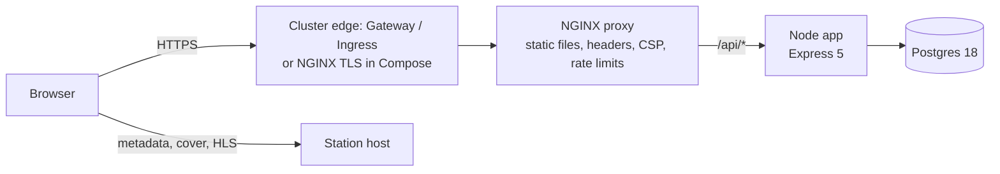

# ADR 0001: Production architecture

- Status: Accepted
- Date: 2026-10-12
- Source: epic #1 (decisions D1 to D14). The user approved them during planning.
- Audit: `docs/audit/containerization-audit.md`

## Context

Radio Learning is a prototype. It has an Express 5 server, a SQLite file and one static
page. The server binds to `127.0.0.1`. It does not stop cleanly. It cannot run behind a
reverse proxy or in a container. The audit lists each cause and names the owner issue.

## Decision

The product changes to a production architecture. NGINX is in front of the Node app. The Node app
uses Postgres. The product runs in Docker Compose and in Kubernetes.

| # | Topic | Decision |
|---|---|---|
| D1 | Staging | Use temporary environments on the GitHub-hosted runner: one Docker Compose and one kind cluster. Remove them after each run. |
| D2 | E2E isolation | Use unique track names for each scenario (in the fake station). Production code gets no test hooks. |
| D3 | Test split | Build: new API tests (`node:test` and `supertest`). Staging: the Cucumber suite, through NGINX. |
| D4 | Build database | The API tests use pg-mem in the Dockerfile `test` stage. Staging E2E uses the real Postgres. |
| D5 | Database | Postgres replaces SQLite fully. There is no data migration, because only development data exists. |
| D6 | Production Postgres | Run Postgres as an in-cluster StatefulSet in all environments. We own the backups: a daily `pg_dump` CronJob and a restore runbook. |
| D7 | Images | Use one multi-stage Dockerfile. `runtime` goes to `ghcr.io/batkomahno2008/radio-learning`. `proxy` goes to `ghcr.io/batkomahno2008/radio-learning-proxy`. Both are published. `e2e` is the test runner (CI only, not published). |
| D8 | Kubernetes | Use plain manifests with Kustomize (`base`, `overlays/staging`, `overlays/prod`). Do not use Helm. |
| D9 | Security | The Security Specialist selects the tools first (#3, #4). The gate starts in report mode. It changes to enforce after remediation (#13). |
| D10 | `@live` | `@live` scenarios run on staging but do not block the pipeline. |
| D11 | TLS | Compose: NGINX stops TLS (D14). Kubernetes: the cluster edge stops TLS. NGINX and the app use plain HTTP inside the cluster. |
| D12 | NGINX role | Use a custom image (`proxy` target) based on `nginxinc/nginx-unprivileged`. NGINX serves `public/` and `/vendor/hls`, and sends `/api/*` to Node. NGINX owns security headers, CSP, rate limits, body size, gzip and access logs. Node serves static files only in local development (`SERVE_STATIC`). |
| D13 | NGINX in Kubernetes | NGINX is its own Deployment and Service in front of the app. The operator chooses the cluster edge: Gateway API `HTTPRoute` (default) or a generic `Ingress` component. Do not use the community `ingress-nginx` controller. It was retired in March 2026. |
| D14 | Compose TLS | NGINX stops TLS with certificate files that the operator mounts. The docs show certbot. Staging uses plain HTTP. |

## Component diagram

Only NGINX is reachable from outside. The app (port 3000) and Postgres (port 5432) are
internal. The browser reads the metadata, the cover art and the HLS stream directly from the station host.

## Consequences

- The `proxy` image holds the static files and the hls.js files. The `runtime` image holds the app code only.
- The CSP must allow the station host (`STATION_ORIGINS`) and the font hosts. The client script moves to `public/app.js`.
- The app needs `/api/health` (liveness, no database) and `/api/ready` (readiness, with database).
- Postgres is a single instance. A failure causes down time and a data risk. The daily backup and the tested restore limit the loss. High availability is a follow-up after #15.
- pg-mem does not act like Postgres in all cases. The SQL stays simple. Staging E2E covers the difference.
- Local development needs a database after #6. See F-OPEN-2 in the audit.

## Alternatives that were not chosen

- Helm: more tools for a small number of manifests (D8).
- The `ingress-nginx` controller: retired (D13).
- A managed Postgres service: the user chose in-cluster Postgres (D6).
- Test hooks in the production code for E2E isolation: unique track names give isolation with no hooks (D2).

## References

- Epic #1 (contracts: variables, ports, endpoints, modules, paths).
- Issues #2 to #16.
